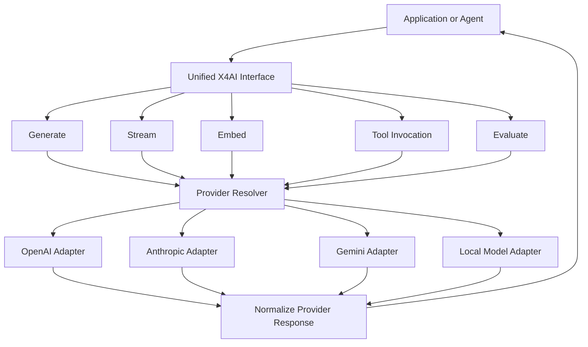

# x4-ai

**Provider-agnostic AI abstraction layer**

Unified generate / stream / embed / tool / evaluate API across OpenAI, Anthropic, Gemini, and local models.

[](LICENSE)
[](CHANGELOG.md)

Part of **[ARIEX4Ops / X4](https://github.com/dhe-cruzer69)**.

---

## Goal

Applications should not rewrite their AI integration when the underlying provider changes.

```python
from x4.ai import X4AI

ai = X4AI()
response = await ai.generate(
    model="openai/gpt-4o",
    messages=[{"role": "user", "content": "Hello"}],
    tools=[...],
)
```

## Architecture

See [ARCHITECTURE.md](ARCHITECTURE.md).

<!-- X4-APEX-DIAGRAM-START:x4-ai -->



<!-- X4-APEX-DIAGRAM-END:x4-ai -->

## Related

- [x4-agents](https://github.com/dhe-cruzer69/x4-agents)
- [x4-core](https://github.com/dhe-cruzer69/x4-core)
- [omniforge](https://github.com/dhe-cruzer69/omniforge) (local-first inspiration)

## License

Apache-2.0

## Support

**[GitHub Sponsors](https://github.com/sponsors/dhe-cruzer69)**
